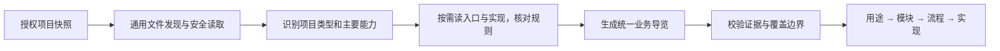

# 跨语言项目通俗导览：调研与落地方案

日期：2026-11-11。状态：已完成通用文本输入、固定快照有界抽样报告和三层页面的首个产品闭环。按需读取 Tool、其他语言结构增强与新人用户研究仍待后续；真实验收见 [产品接入记录](PROJECT_GUIDE_IMPLEMENTATION.md)。

## 1. 目标

读者没有多少编程基础，也能依次回答：项目干什么、给谁用、有哪些模块、模块里有什么能力、典型事情如何完成。只有需要深入时才进入技术与代码。

适用对象从 Java 项目扩大为可访问的多语言软件、脚本、库、前端、数据/AI、移动端、游戏、基础设施及混合项目。通用的是调查与解释流程；不承诺任意二进制、混淆程序或缺失外部系统均能被准确反向还原。

交付物：

- [可携带的 project-guide skill](skills/project-guide/SKILL.md)。目前保存在仓库文档区，可按路径让 Agent 读取；没有修改全局配置或安装第三方 skill。
- [可复制的独立提示词](PROJECT_GUIDE_PROMPT.md)。供具备文件读取能力的 AI 使用。
- 本文：产品形态、技术边界、开发顺序和验收方式。

## 2. 公开资料调研

通过网页检索、官方文档、GitHub README 和 SKILL.md 原文核对。仅调研，没有安装或运行下列软件；功能描述来自其资料，不代表在本机通过验收。可变链接的访问日期为 2026-11-11。

| 项目 / 技能 | 核对到的机制 | 借鉴点 | 对当前目标的局限 |
|---|---|---|---|
| [PocketFlow Tutorial Codebase Knowledge](https://github.com/The-Pocket/PocketFlow-Tutorial-Codebase-Knowledge) | 从代码识别核心抽象、分析关系、排序章节，再写面向新人的教程；支持指定中文 | 先交代问题和具体场景，再解释能力；阅读顺序有依赖关系 | 完整教程容易过长，也偏代码概念；需压缩为业务首屏与按需阅读 |
| [Understand Anything](https://github.com/Egonex-AI/Understand-Anything) 及 [understand-onboard skill](https://github.com/Egonex-AI/Understand-Anything/blob/main/understand-anything-plugin/skills/understand-onboard/SKILL.md) | 有通俗摘要、Guided Tours、知识图谱；onboard skill 使用已有图谱、检查版本、读文件级节点生成导览 | 版本感知、分层解释、引导式学习路线 | onboard skill 需要先生成图谱，默认章节仍偏架构层和文件；不适合原样作为新人业务首页 |
| [ECC codebase-onboarding skill](https://github.com/affaan-m/everything-claude-code/blob/main/skills/codebase-onboarding/SKILL.md) | 跨语言侦察清单，识别入口、追踪生命周期，强调两分钟可扫读 | 不预设语言，先侦察再定向阅读 | 默认还产出 CLAUDE.md 和工程约定；本方案只做导览，不自动改规则文件 |
| [DeepWiki 官方文档](https://docs.devin.ai/work-with-devin/deepwiki) | 自动 Wiki、架构图和源码引用；可用 `.devin/wiki.json` 配置页面、父子层级和说明重点 | 先概要再下钻，页面规划应围绕读者问题；资料可供问答复用 | 默认完整 Wiki 仍偏工程师，需要自行收敛内容层次 |
| [Google Code Wiki 官方介绍](https://developers.googleblog.com/introducing-code-wiki-accelerating-your-code-understanding/) | 结构化 Wiki、代码链接、仓库问答和关系图 | 概念说明可跳到实际实现，导览与聊天共享上下文 | 官方介绍的是较全面的开发者理解平台，不能直接推断其新人业务解释效果 |
| [Microsoft CodeTour](https://github.com/microsoft/codetour) | 在目录、文件和行上编排可回放的导览步骤；可固定 Git ref | “下一步看这里”比一整张调用图更容易开始 | 偏编辑器内代码导览，不能单独生成业务解释，也不应照搬其命令执行能力 |
| [DeepWiki-Open](https://github.com/AsyncFuncAI/deepwiki-open) | README 描述交互式 Wiki、图示与 codemap 导览，当前指向 Grok-Wiki | 开源产品的信息组织可作补充参考 | 当前 README 已简化并导向新版下载，不据此认定旧教程/部署方式仍有效 |

关键实现依据：PocketFlow 的 [flow.py](https://github.com/The-Pocket/PocketFlow-Tutorial-Codebase-Knowledge/blob/05b24cbbb0fe409c5e23c9791f0342f07524ffdc/flow.py) 明确采用 FetchRepo → IdentifyAbstractions → AnalyzeRelationships → OrderChapters → WriteChapters → CombineTutorial；[nodes.py](https://github.com/The-Pocket/PocketFlow-Tutorial-Codebase-Knowledge/blob/05b24cbbb0fe409c5e23c9791f0342f07524ffdc/nodes.py) 要求用中心场景与类比解释概念。这是流程借鉴，不是把其代码或框架嵌入 Java 服务。

GitHub 调研时记录的 main revision（便于后续复核资料漂移）：

- PocketFlow：`05b24cbbb0fe409c5e23c9791f0342f07524ffdc`。
- Understand Anything：`532a2e97dc007104f9a1b8d11b6cc16ae7c8cd3a`。
- ECC：`d2ef2680594f9a17526a6e1a2e18b3d242c5d17b`。
- CodeTour：`29955a004445d3fd2ad5df35dd00f9cc0400ba7d`。
- DeepWiki-Open：`e7fd468bad800be8fa409b6653d5b5a371e75dce`。

结论：最适合的组合是 PocketFlow 的“先理解概念与场景”、Understand Anything/CodeTour 的“引导式深入”、DeepWiki/Code Wiki 的“证据和问答衔接”。不建议把完整知识图谱、全量 Wiki 或逐接口报告设为默认首页。

## 3. 改造前的问题（设计时基线）

以下是代码观察，未用本轮调研冒充页面实测：

- [ProjectUnderstandingWorkspace.vue](../frontend/src/components/ProjectUnderstandingWorkspace.vue) 首屏主要统计 Java 文件、符号、包和调用关系，还把审查流水线放在理解入口旁。
- [SourceStructureModal.vue](../frontend/src/components/SourceStructureModal.vue) 把静态导览、AI 报告、能力标签、流程、接口、状态、表和阅读建议集中在长弹窗里；静态流程的“对外接口”默认展开。
- [ProjectBusinessMapService.java](../src/main/java/com/devmate/knowledge/service/ProjectBusinessMapService.java) 的 `buildModules` 按 Controller 符号分组。这是可核验的工程入口分组，不等同于面向用户的业务模块。
- [SourceImportService.java](../src/main/java/com/devmate/knowledge/service/SourceImportService.java) 在没有 Java 文件时直接拒绝导入；[SourceFileType.java](../src/main/java/com/devmate/knowledge/source/SourceFileType.java) 仅识别 JAVA、YAML、PROPERTIES、SQL。
- [ProjectUnderstandingReportService.java](../src/main/java/com/devmate/knowledge/service/ProjectUnderstandingReportService.java) 现有 Prompt 明确定位“Java 架构师”，输入依赖 Java 静态业务地图和已入库 Chunk。

因此要同时改信息组织和语言入口。只换成一个“分析所有语言”的 Prompt，非 Java 源码仍进不了证据层。

## 4. 推荐的页面形态

一个项目只有一份业务导览，展示为三个深度，不并排放两套静态/AI 报告：

```text
项目首页
  ├─ 一句话：它帮谁解决什么问题
  ├─ 一个具体使用场景
  ├─ 主要模块：中文名称 + 职责 + 能做哪些事
  ├─ 主要流程：触发 → 处理/关键判断 → 结果
  └─ 需要知道的限制与未完成部分
          ↓ 选择一个模块或流程
      参与者、步骤、规则、结果与失败情况
          ↓ 点击“查看实现依据”
      实际文件、符号、代码、测试和推荐阅读顺序
```

首屏目标是约两分钟可读完，不靠把文字缩小来塞入更多信息。模块通常先展示四至八组，但数量由项目决定；大型项目提供“其余模块/子项目”入口，避免用简洁掩盖遗漏。

以一个假设的购物项目说明展现方式（以下不是当前导入仓库的实测结论）：

- 项目用途：帮助顾客选购商品并完成购买。
- 模块：商品浏览、购物车、下单、订单查询；某能力仅演示时就在名称旁标明。
- 流程：挑商品 → 放入购物车 → 确认数量 → 检查库存 → 创建订单。
- 点“下单”后才说明库存不足、价格变化等**实际有证据的**判断，再提供代码入口。

编程库则换成“调用者、公开能力、输入输出”；CLI 换成“输入文件、处理规则、输出结果”，不套购物项目模板。

界面操作收敛为“先看懂”“了解这块业务”“查看实现依据”“继续问”。首次访问无需会提问，聊天作为上下文追问入口；源码统计、检索参数、模型耗时和审查工具放进高级区。

## 5. 通用拆解如何工作



AI 负责归纳“这些文件共同解决什么问题”、组织模块和解释业务逻辑。程序负责版本、访问范围、文件读取、证据位置、预算与结果校验。结构解析器负责增强已支持语言的定位，不作为生成高层导览的必要前提。

### 三种实际能力

1. **通用文本导览**：安全读取多语言源码、清单与文档，AI 按入口与实现做概括。多数文本项目可走这一层，报告包含实际覆盖范围。
2. **结构增强下钻**：已有 Java AST 继续复用；其他语言按需求加 Tree-sitter/LSP/框架适配，用于符号、引用和更准的定位，不声称语法解析等于理解业务。
3. **部分可读 / 不可确认**：二进制资产、反射运行时、外部服务、跨仓缺失等保留为边界。只凭客户端请求不能确认远端已实现。

这套 skill 不是运行时解析器。让 Codex 等现成 Agent 读取 skill 可立即做一次分析；让 DevMate 网页执行同样流程，还需要下面的受控工具和数据契约。

### 产品内的只读工具

建议由 Java 宿主暴露 `get_project_snapshot`、`list_project_tree`、`search_project_text`、`read_project_file`；已有能力再提供 `list_symbols` 与 `get_references`。工具名是设计建议，当前尚未全部实现。

- 每次调用检查用户、项目和快照；限制路径、符号链接、单次返回长度、总文件字节、次数与时间。
- 搜索与读取先过滤凭据、生成产物和非授权内容；上传给当前账户模型的代码片段仍遵循项目已有授权及隐私配置，不因新 skill 自动获得外传权限。
- 不给模型任意 Shell、SQL、数据库或目标仓库脚本执行入口。
- 先做代表性证据抽样再生成，不把整个仓库塞进一次模型上下文。不要默认用多个 Agent 反复全仓扫描。
- 超预算返回部分结果和遗漏范围；付费模型请求失败复用原幂等键，不无限重试。

### 报告与缓存

建议定义版本化 `ProjectGuide` 契约，核心为 `project / modules / flows / glossary / openQuestions / coverage / evidence`，细节见 [输出约定](skills/project-guide/references/output-contract.md)。接口/DTO 和校验须先于 UI 实现；这不是现有接口已具备的字段。

报告与证据固定快照。缓存键包含项目、快照、读取/排除配置、Prompt 版本、模型配置版本、输出语言/深度；仅用 Git revision 会遗漏未提交修改。旧版报告按旧版本读取，不能原地篡改既有迁移。

保留现有鉴权、MySQL、模型连接、SSE、任务状态和短事务方式，不引入微服务、MQ、Redis 或向量数据库。数据库只持久化任务/结果/引用，模型调用和文件扫描放在事务之外。

## 6. 最小落地顺序

| 阶段 | 交付 | 验收 |
|---|---|---|
| A：先验证解释方法 | 本轮 skill、独立提示词、合成项目试用 | Python CLI 不被解释为 Web 系统；Mock/文档冲突被识别，输出保持新人可读 |
| B：开放通用输入 | 独立的文本发现/读取能力，不再要求有 Java；Java AST 按类型调用 | 纯 TS、Python、Go/混合仓可进入导览，真实权限、路径和预算校验通过 |
| C：通用报告闭环 | 只读工具、版本化导览 DTO/OpenAPI、证据校验、模型生成和持久化 | 正常、缺证据、超时、权限、重放、快照变化、Mock 与注入场景都有结果 |
| D：新人页面 | 默认用途/模块/流程，按需展开业务细节与实现 | 未接触仓库的人能复述用途、找到模块和关键判断，刷新仍可恢复报告 |
| E：逐步加精度 | 优先补真实需求最多的语言结构增强与主题问答 | 提高定位能力有实际样例支撑，不以“支持文件后缀数”冒充业务理解质量 |

Java 审查作为已有高级能力保留；支持通用导览并不自动让 PMD 和 Java 项目规则适用于所有语言。调整主入口后，审查按钮应按实际分析能力显示。

## 7. 验证与未完成项

此处最初记录方法设计阶段。产品实现及真实样例已另记于 [产品接入记录](PROJECT_GUIDE_IMPLEMENTATION.md)；以下 skill 验收仍保留原始范围。方法验收记录见 [skill 行为验证](PROJECT_GUIDE_VALIDATION.md)。合成样例验证用于暴露错误，不替代真实仓库评测。

建议下一阶段至少选择：一个真实前后端项目、一个纯前端项目、一个 Python CLI/库、一个多语言仓库，再用文档-only、缺失服务和二进制案例检查降级。找三位没读过仓库的读者做两分钟任务测试；“两分钟”是目标，不是本轮已测出的成绩。

检验维度是用途是否正确、模块是否按能力组织、主要流程和关键规则是否有证据、Mock/计划是否区分、遗漏范围是否透明、是否能找到深入入口。语法/Schema 校验和模型自评分不能替代这些核对。

## 8. 个人知识库的方法来源

按需阅读了 AI 编程资料导航、UI 设计提示词的场景选择、成果物驱动的 AI 开发协作流程、原始提示词的冲突与修正清单，采用其中“先定目标与信息层级、产出可检查成果物、以行为和证据验收”的方法。本轮未读取或执行其中 DOCX/PPTX 原件，没有把参考资料中的角色描述当成执行授权。
